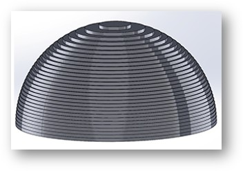
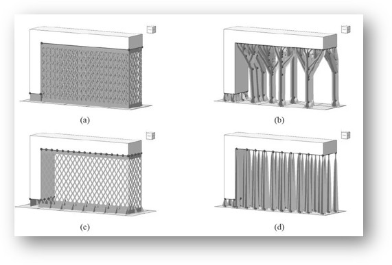
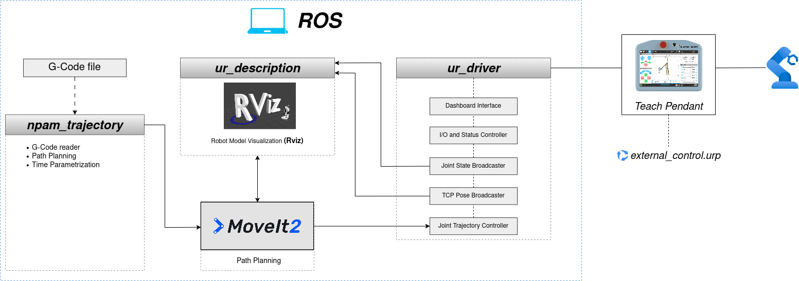

<a name="home"></a>

<div align="center">
  
# Robot-Based Non-Planar Additive Manufacturing · RBNPAM

**Path Planning Architecture · ROS 2**

<sub>Design of a digital architecture for additive manufacturing processes, integrating physical system communication and synchronization, path planning, trajectory execution, and simulation environment configuration using ROS 2 and MoveIt 2.

<br>


 
<br>

[Overview](#overview) · [Quick start](#quick-start) · [Demo](#demo) · [Technical documentation](#technical-documentation)

</div>

<a name="overview"></a>
## Overview

### Motivation

Conventional additive manufacturing processes face several limitations, including the staircase effect (Figure 1a), the need for support structures (Figure 1b), and the anisotropy of mechanical properties [(link)](<https://eddm.es/blog-ingenius/design-for-additive-manufacturing-anisotropia-en-impresion-3d/>). Robotic-based non-planar additive manufacturing (RBNPAM) has emerged as a promising approach to overcome these limitations by exploiting robotic manipulators and non-planar deposition strategies.

<div align="center">
<table>
  <tr>
    <td align="center" valign="bottom">
      
      <br>
      <sub><b>Figure 1a.</b> Staircase effect. Source: <a href="https://support.3dverkstan.se/article/38-designing-for-3d-printing"> 3DVerkstan, 2015</a></sub>
    </td>
    <td align="center" valign="bottom">
      
      <br>
      <sub><b>Figure 1b.</b> Support structures.</sub>
    </td>
  </tr>
</table>
</div>

However, the increased flexibility of robotic manufacturing also introduces significant challenges in slicing and trajectory planning. In RBNPAM, the deposition path is no longer restricted to conventional planar layers, as the geometry of the deposited material and the orientation of the deposition process may vary throughout the process. This increases the complexity of generating feasible manufacturing paths and coordinating them with the robot's motion. Unlike conventional 3D printing, robotic execution must account for additional factors such as kinematic constraints, tool orientation, and potential collisions with the workpiece and surrounding equipment.

### Project Contribution

This project proposes a digital architecture for the study of non-planar additive manufacturing workflows. The architecture integrates the main components of the manufacturing station, focusing particularly on robot control and communication, the configuration of the simulation environment, and trajectory planning using ROS 2 and MoveIt 2.  

The work focuses on integrating these components and developing a planning framework that takes a sequence of points generated by the slicing process as the input. These points are processed into robot motions through trajectory generation within the ROS 2 and MoveIt 2 environment. The resulting architecture provides a documented starting point for further development of trajectory planning strategies for robotic non-planar additive manufacturing.

### Project Context

This project is part the research on [robotic-based non-planar additive manufacturing](<https://oa.upm.es/91031/>) conducted at the Escuela Técnica Superior de Ingenieros Industriales (ETSII), Universidad Politécnica de Madrid (UPM). This broader research is structured around four complementary objectives: non-planar slicing and path-planning strategy, non-solid infilling generation methodology, robotic manufacturing cell setup, and the integration of planning algorithms and hardware into a complete manufacturing workflow. Within this context, the present repository focuses on the digital architecture required to integrate robot communication and control, simulation, and path planning.

The implementation builds primarily on the ROS 2 tools and repositories provided by Universal Robots. It was also developed in parallel with the INGENIA 2025/26 course at ETSII-UPM, supporting the complementary development of a comprehensive workflow for RBNPAM processes. 


<a name="#quick-start"></a>
## Quick start

### Prerequisites
 
**Software**
 
| Requirement | Version |
|-------------|:-------:|
| Ubuntu | 22.04 LTS |
| ROS 2 | [Humble Hawksbill](https://docs.ros.org/en/humble/Installation.html) |
| MoveIt 2 | Humble-compatible |
| Python | 3.10+ |
 
**Hardware**
 
- Universal Robots UR10 robot (CB3 / e-Series compatible).
- Direct Ethernet connection between the control PC and the robot controller.
### Installation
 
**1. Install development tools**
 
Update the package list and install the required system tools:
 
```bash
sudo apt update
sudo apt install python3-colcon-common-extensions python3-rosdep git -y
```
 
**2. Clone the repository**
 
Create a workspace folder and clone this repository:
 
```bash
mkdir -p ~/workspace/src
cd ~/workspace/src
git clone https://github.com/PedroAcero/tfm_workspace.git
```
 
**3. Install system dependencies**
 
Install the ROS 2 packages required before building:
 
```bash
sudo apt install \
  ros-humble-tf2-kdl \
  ros-humble-kdl-parser \
  ros-humble-moveit \
  ros-humble-ur-robot-driver \
  ros-humble-ur-msgs \
  ros-humble-generate-parameter-library \
  ros-humble-generate-parameter-library-py \
  ros-humble-ur-client-library \
  ros-humble-realtime-tools -y
```
 
**4. Install remaining dependencies with rosdep**
 
`rosdep` analyses the packages in the workspace and automatically installs any missing dependency:
 
```bash
cd ~/workspace
sudo rosdep init 2>/dev/null || true
rosdep update
rosdep install --from-paths src --ignore-src -r -y
```
 
**5. Build**
 
Build all the workspace packages. The `--allow-overriding` flag is required because some packages in this repository override others already installed on the system:
 
```bash
cd ~/workspace
colcon build \
  --allow-overriding ur_description ur_moveit_config ur_controllers ur_robot_driver ur_calibration ur_dashboard_msgs ur_bringup \
  --cmake-args -DCMAKE_BUILD_TYPE=Release
```
 
> [!WARNING]
> In case of an error during installation, refer to the [troubleshooting guide](src/docs/troubleshooting.md).
 
**6. Source the workspace**
 
Every time you open a new terminal where you want to use the workspace, you need to source the compiled files:
 
```bash
source ~/workspace/install/setup.bash
```
 
To avoid doing this in every new terminal, add the command to your `.bashrc`:
 
```bash
echo "source ~/workspace/install/setup.bash" >> ~/.bashrc
```
 
**7. Verify the installation**
 
In a new terminal, check that all packages are available:
 
```bash
ros2 pkg list | grep npam
ros2 pkg list | grep ur_
```
 
The output should include `npam_logger`, `npam_trajectory` and all the packages developed by [Universal Robots](https://github.com/UniversalRobots):
 
- `ur_description`
- `ur_moveit_config`
- `ur_controllers`
- `ur_robot_driver`
- `ur_calibration`
- `ur_dashboard_msgs`
### Running the Project
 
**(Optional) Simulation without hardware**
 
To test without hardware, a simulated environment packaged as a Docker image is available. See the simulation setup guide for configuration details. <!-- TODO: link to simulation doc -->
 
```bash
ros2 run ur_client_library start_ursim.sh -m ur10
```
 
**Real robot**
 
To work with the real robot, first power on the UR10 controller and the Teach Pendant. For the Ethernet connection setup between the PC and the robot, see the network configuration guide. <!-- TODO: link to network doc -->
 
**1. Start the ROS communication driver**
 
```bash
ros2 launch ur_robot_driver ur_control.launch.py ur_type:=ur10 robot_ip:=192.168.XX.XXX launch_rviz:=false
```
 
**2. Run `external_control.urp`**
 
Run the `external_control.urp` program from the Teach Pendant before continuing. Without this step, MoveIt 2 cannot send commands to the robot.
 
**3. Start MoveIt 2**
 
```bash
ros2 launch ur_moveit_config ur_moveit.launch.py ur_type:=ur10 launch_rviz:=true
```
 
> [!NOTE]
> It is recommended to start the driver and MoveIt 2 in two separate terminals, so that the messages of each component can be identified and analysed independently.
 
**4. Execute trajectories**
 
Select the desired planner to run the trajectories:
 
```bash
ros2 launch npam_trajectory pilz_trajectory.launch.py
```
 
---


<a name="#demo"></a>
## Demo 

The following video demonstrates the developed ROS 2 architecture for a RBNPAM workflow, from trajectory processing and motion planning to robot control and extrusion system integration.
 
The architecture connects the `npam_trajectory` package with MoveIt 2 and the Universal Robots ROS 2 Driver, while RViz 2 provides a visualization environment for the robot model and planned motions. In parallel, a micro-ROS agent enables communication with the microcontroller responsible for extrusion and temperature control.
 
**Key aspects demonstrated:**
 
- **Trajectory processing:** reading the waypoints from a G-code file and processing the input path for robotic execution.
- **Motion planning:** generating robot trajectories with MoveIt 2, accounting for robot kinematics and motion constraints.
- **Visualization:** inspecting the robot model and planned motions in RViz 2.
- **Robot control:** integrating ROS 2 with the UR10 through the Universal Robots driver.
- **Process integration:** coordinating robot motion with the extrusion and temperature control subsystems.
  
### Demonstration Video

https://github.com/user-attachments/assets/d3f98c0b-bcc9-4f4c-9425-575a91952ca3

[▶ Watch the full video](src/docs/video/tfm_comprimidp.mp4)


<a name="#technical-documentation"></a>
## Technical documentation

## Technical documentation

### System architecture

The diagram below shows a simplified view of the proposed architecture. Everything inside the dashed blue frame runs on the control PC under ROS 2, while the UR10 robot, its Teach Pendant and the extrusion hardware are external to it.

<div align="center">
  
  <br>
  <sub><b>Figure 2.</b> Simplified architecture of the proposed system.</sub>
</div>

<br>

The process starts with a **G-code file**, which is handled by the `npam_trajectory` package. This package reads the G-code, plans the path, applies the time parametrization and synchronizes the robot motion with the extrusion and temperature control.

The resulting path is passed to **MoveIt 2**, which plans the motion according to the robot kinematics and constraints, and sends the trajectory to the Joint Trajectory Controller of the **Universal Robots driver** (`ur_driver`). The driver communicates with the UR10 through the Teach Pendant, where the `external_control.urp` program must be running, and also provides the dashboard interface, the I/O and status controller, and the joint state and TCP pose broadcasters. These broadcasters feed `ur_description`, so that **RViz 2** displays the robot model and the planned motions.

In parallel, the **micro-ROS agent** connects the ROS 2 system with a microcontroller (MCU), which is responsible for the extruder control and the temperature control of the hotend.


### Detailed documentation

The following documents expand on specific aspects of the project:

<table>
  <tr>
    <td width="180" align="center">
      <a href="src/docs/simulation.md">
        
      </a>
    </td>
    <td>
      <b><a href="src/docs/simulation.md">1. Simulation environment</a></b><br>
      Configuration of the simulated environment with URSim and Docker, used to test the architecture without physical hardware.
    </td>
  </tr>
  <tr>
    <td width="180" align="center">
      <a href="src/docs/planning.md">
        
      </a>
    </td>
    <td>
      <b><a href="src/docs/planning.md">2. Trajectory planning</a></b><br>
      G-code processing and motion planning with MoveIt 2, including the planning algorithms used and their configuration.
    </td>
  </tr>
  <tr>
    <td width="180" align="center">
      <a href="src/docs/troubleshooting.md">
        
      </a>
    </td>
    <td>
      <b><a href="src/docs/troubleshooting.md">3. Troubleshooting</a></b><br>
      Common installation and build errors, with their causes and solutions.
    </td>
  </tr>
  <tr>
    <td width="180" align="center">
      <a href="src/docs/future_work.md">
        
      </a>
    </td>
    <td>
      <b><a href="src/docs/future_work.md">4. Future work</a></b><br>
      Limitations of the current implementation and proposed lines of development.
    </td>
  </tr>
</table>


:house: [HOME](#home)
