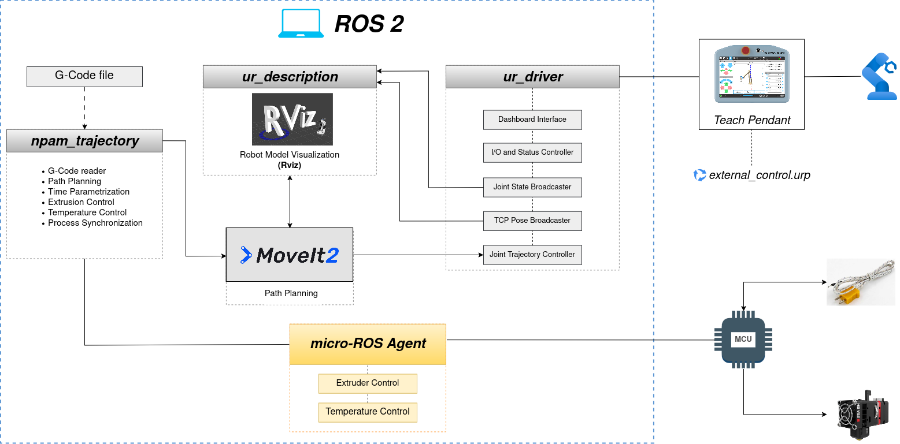

# Future Work

This document collects the lines of development proposed to continue this project. They build on the architecture described in the [Technical documentation](../../README.md#technical-documentation), 
on the planning strategies of [Trajectory Planning](planning.md) and on the results of the [Experimental Validation](validation.md).

## Overview

| # | Line | Goal |
|---|------|------|
| 1 | [Peripherals integration](#1-integration-of-the-peripherals-via-micro-ros) | Control the extruder and the thermocouple through micro-ROS, synchronized with the robot motion |
| 2 | [New planning strategies](#2-new-planning-strategies) | Explore alternatives to the current planners, keeping the control of the TCP velocity |
| 3 | [Dynamic characterization](#3-detailed-dynamic-characterization) | Study the influence of the planning and execution parameters on the real motion |

---

## 1. Integration of the peripherals via micro-ROS

The architecture already includes a micro-ROS agent that connects ROS 2 with a microcontroller (MCU), which is responsible for the extruder and for the temperature control. The next step 
is to integrate the control of these peripherals (the extruder and the thermocouple) in the execution workflow, **synchronized with the motion of the robot**.

### 1.1 Proposed approach

The idea is to find an existing topic, or to implement a new one, that activates the extruder while the robot moves. The information about *when* to extrude and *at what speed* 
would come from the G-code itself.

  
   
  <b>Figure 1.</b> Simplified architecture of the proposed system.

 

### 1.2 Points to address

- **Information from the G-code:** slicers usually encode the extruded amount and the feed rate in the motion commands (`E` and `F` words of `G1`) and the temperature in dedicated commands 
(`M104`, `M109`). The function `gcode_reader()` would have to extract this information together with the waypoints, and has to send the extruder speed and thermocouple activation data to 
topics yet to be designed.
- **Relation with the TCP velocity:** to keep a uniform bead, the extrusion rate has to be consistent with the tangential velocity of the TCP. By conservation of volume, the filament 
feed speed is the TCP speed multiplied by the ratio between the cross-section of the deposited bead and the cross-section of the filament. This is why `max_trans_vel` is the key parameter 
of the NPAM process.

$$\dot{q}_{in} =  \frac{\pi \, \phi^2}{4} * f$$ and $$\dot{q}_{out} = △h * w * u$$

Therefore, by conservation of volume, and solving for the extrusion speed: 

$$f = \frac{4 * △h * w}{\pi * \phi^2} * u$$

**Notation**

| Symbol | Description | Unit |
|:------:|-------------|:----:|
| $f$ | Feed speed of the filament | mm/s |
| $\phi$ | Diameter of the filament | mm |
| $u$ | Tangential velocity of the TCP (relative speed between the nozzle and the surface) | mm/s |
| $h$ | Layer height (thickness of the bead, normal to the surface) | mm |
| $w$ | Width of the bead | mm |
| $\dot{q}$ | Volumetric flow rate | mm³/s |

- **Synchronization:** the extrusion has to start and stop in coordination with the execution of the trajectory, and its speed should follow the real velocity of the TCP. The planner may 
introduce additional waypoints during trajectory computation. Therefore, the proposed solution must account for this behavior and ensure that the extruder speed especified in the G-Code 
file is maintained between each pair of consecutive points.
- **Temperature:** The thermocouple must act as a process interlock, preventing the robot from moving or starting filament extrusion until the nozzle reaches the target temperature. This 
ensures that the manufacturing process only begins once the required temperature has been reached.
- **Safety:** if the trajectory is interrupted, for example by a disconnection of the External Control, the extruder has to stop. A mechanism that stops the extrusion when the communication 
is lost (a watchdog in the MCU) should be considered.

---

## 2. New planning strategies

The Pilz Industrial Motion Planner remains the most interesting strategy, precisely because it takes the **tangential velocity of the TCP** into account, which is the magnitude that matters 
most for the process. The following alternatives could be explored, as complements or as replacements of specific steps of the workflow.

| Strategy | Type | Possible role | Comment |
|----------|------|---------------|---------|
| TOTG (*Time-Optimal Trajectory Generation*) | Time parametrization | Replace IPTP after the Cartesian interpolation | It is not a planner: it assigns timing to a geometric path, respecting 
velocity and acceleration limits. It is available in MoveIt |
| OMPL | Sampling-based planners | Motions outside the deposition (approach, retreat, travel between regions) | It does not follow a prescribed Cartesian path, so it is not suitable for the 
deposition itself |
| Pilz `PTP` | Point-to-point planner | Travel motions between deposition paths | Same planner as the one used for deposition |
| Pilz `CIRC` | Circular planner | Arcs of the G-code (`G2`, `G3`) | It would avoid approximating arcs with many short linear segments |
| Pilz sequences with blending | Pilz, `blend_radius` > 0 | Continuous motion through the waypoints | See [section 3](#3-detailed-dynamic-characterization) |
| Optimization-based planners (STOMP, CHOMP) | Joint-space optimization | Smoother joint motions | They do not control the TCP velocity natively |

Two more ideas concern the **execution** instead of the planning:

- **Cartesian controllers:** following the Cartesian path directly at controller level, instead of converting it to joint trajectories.
- **Forwarding to the robot controller:** the Universal Robots driver includes a passthrough trajectory controller that forwards trajectories to the own motion engine of the robot. It would 
make it possible to compare the ROS 2 workflow with the native behavior of the robot, which is the way the dynamic behavior was studied until now. The supported trajectory types depend on the 
version of the driver and have to be checked.

> [!NOTE]
> Any new strategy should be evaluated with the same criteria used in this work: control of the TCP velocity, handling of the time parametrization, and behavior with respect to the joint 
limits.

---

## 3. Detailed dynamic characterization

The experimental validation studied the influence of the velocity scaling and the estimation of `max_trans_vel`. A systematic characterization would extend it to the rest of the parameters of 
the workflow, and would also help to define the **technological limits of the process**, that is, the velocities and accelerations that the system can actually track.

### 3.1 Parameters to study

| Parameter | Where | What to study |
|-----------|-------|---------------|
| `velocity_scaling`, `acceleration_scaling` | Cartesian planner (IPTP) | Influence on the planned profile and on the setpoint actually reached during the execution |
| `blend_radius` | Pilz sequence | Continuity of the velocity, deviation from the nominal path and limits of the radius (see below) |
| `max_trans_vel` | `pilz_cartesian_limits.yaml` | Sweep of values using the [workflow](validation.md#5-workflow-for-a-new-trajectory), comparing the measured and the commanded velocity of 
the TCP |
| `max_trans_acc`, `max_trans_dec`, `max_rot_vel` | `pilz_cartesian_limits.yaml` | Duration of the ramps of the velocity profile and their effect at the waypoints |
| `eef_step`, `jump_threshold` | `computeCartesianPath()` | Resolution of the interpolation and detection of discontinuities in joint space |
| Tracking tolerance | `scaled_joint_trajectory_controller` | Behavior when the tracking error grows, and aborted executions |
| Speed scaling of the Teach Pendant | Robot | Effect on the real execution time of a trajectory |
| Density of the waypoints | G-code | Effect of the length of the segments on the velocity profile |

Suggested metrics: error between the planned and the commanded motion, whether the commanded velocity reaches its setpoint, velocity of the TCP in m/s, relative use of the limit of each 
joint, tracking error and total duration.

### 3.2 The `blend_radius` parameter

In the current implementation the sequences are built with `blend_radius = 0.0`. In that case the segments are simply concatenated, and since each `LIN` segment starts and ends at rest, 
the velocity of the TCP goes to zero at every waypoint.

> [!NOTE]
> The stops can be very short. A ramp lasts approximately the velocity divided by the acceleration, which for low velocities and high acceleration limits is a few milliseconds, so the motion 
can look continuous. Checking the planned velocities at the waypoints, and the values of `pilz_cartesian_limits.yaml`, would confirm it. 

Using a `blend_radius` greater than zero would make the robot pass next to each waypoint without stopping, which is closer to what a continuous deposition needs. 
Several aspects have to be studied:

- **Geometric deviation:** with blending, the TCP does not pass exactly through every waypoint. There is a trade-off between the continuity of the velocity and the fidelity to the nominal path.
- **Constraints of the planner:** the blend radius of the last item of a sequence has to be zero, and the radius of consecutive items cannot overlap. In practice, each segment has to be 
longer than the sum of the radius of its neighbors, so denser waypoints require smaller radius.
- **Short segments:** the profile of a very short segment may not reach `max_trans_vel`, so the measured velocity of the TCP could be lower than the setpoint. It has to be compared with the 
logs.
- **Effect on the extrusion:** a continuous velocity of the TCP simplifies the synchronization with the extruder described in [section 1](#1-integration-of-the-peripherals-via-micro-ros).

### 3.3 Technological limits of the process

Beyond the limits of the robot, the process has its own limits: the maximum flow that the extruder and the hotend can deliver, the response time of the temperature control, and the velocities 
at which the deposition remains uniform. Combining the dynamic characterization of the robot with the integration of the peripherals would make it possible to define the real operating range 
of the system.
