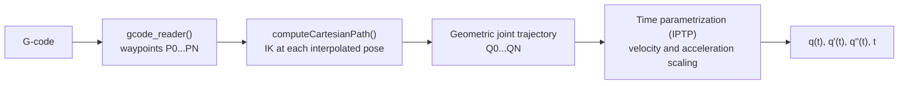
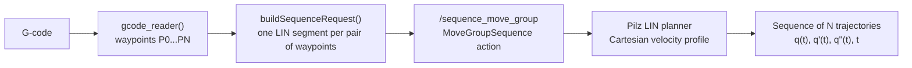

# Trajectory Planning

This document describes the planning part of the proposed architecture: how a G-code file is converted into a trajectory that the UR10 can execute, and the two planning strategies implemented in the `npam_trajectory` package. For the installation steps see the [Quick start](../../README.md#quick-start), and for the configuration of the robot model see the [simulation environment](simulation.md).

## Objective

One of the objectives of this work is to **characterize the dynamic behavior of the system**. Until now, this was done only through Polyscope, the interface of the Teach Pendant. The goal here is different: to provide a set of **standardized steps to execute any trajectory** received by the system, so that the behavior of the robot can be studied in a repeatable way.

To achieve this, two planning strategies were implemented:

| Strategy | Based on | Main idea |
|----------|----------|-----------|
| [Cartesian interpolation](#3-strategy-1-cartesian-interpolation) | `computeCartesianPath()` of MoveIt 2 | Interpolate the path in Cartesian space and solve the inverse kinematics point by point. Timing is added afterwards. |
| [Pilz Industrial Motion Planner](#4-strategy-2-pilz-industrial-motion-planner) | `LIN` planner of Pilz | Plan one linear segment between consecutive waypoints, with a velocity profile defined in Cartesian space. |

> [!IMPORTANT]
> In a non-planar additive manufacturing process, the **linear velocity of the TCP** has to be controlled precisely. In this station the TCP moves the print bed under a fixed extruder, so the TCP speed is the relative speed between the nozzle and the surface. To obtain a uniform deposition, the extrusion rate has to be consistent with that speed. This is the main criterion used to compare the two strategies.

## Overview

| # | Section | Content |
|---|---------|---------|
| 1 | [Planning architecture](#1-planning-architecture) | Components, interfaces and information flow |
| 2 | [Common input: G-code](#2-common-input-g-code) | Waypoints extracted from the G-code |
| 3 | [Cartesian interpolation](#3-strategy-1-cartesian-interpolation) | Algorithm, parameters and time parametrization |
| 4 | [Pilz Industrial Motion Planner](#4-strategy-2-pilz-industrial-motion-planner) | Algorithm, constraints and Cartesian limits |
| 5 | [Comparison and recommended workflow](#5-comparison-and-recommended-workflow) | How to combine both strategies |
| 6 | [Experimental validation](#6-experimental-validation) | Test trajectory and results |

---

## 1. Planning architecture

The following diagram is the same architecture presented in the [Technical documentation](../../README.md#technical-documentation), but with the names of the interfaces and controllers actually used. It makes it possible to follow the information flow from the G-code to the execution of the trajectory.

  
   
  <b>Figure 1.</b> Planning architecture: <code>npam_trajectory</code>, <code>move_group</code>, <code>ros2_control</code> and RViz 2.

<!-- Figure 1: the architecture diagram with the four blocks (npam_trajectory, move_group, ros2_control, RViz) and the topics, services and actions between them. -->

 

The system is organized in three blocks, plus the visualization:

- **`npam_trajectory`** (own package): reads the G-code with `gcode_reader()` and offers the two planners, `CartesianPlanner` and `PilzPlanner`. Both planners end in `execute()`, which sends the final trajectory for execution. The package communicates with MoveIt 2 through `MoveGroupInterface` and an action client of type `MoveGroupSequence`.
- **`move_group`** (MoveIt 2): provides the planning and execution services of MoveIt. It keeps the planning scene up to date (`PlanningSceneMonitor`) and sends the trajectories to the controllers through `MoveItSimpleControllerManager`, using the `FollowJointTrajectory` interface.
- **`ros2_control`** (Universal Robots driver): the `ControllerManager` hosts the controllers (`scaled_joint_trajectory_controller`, `joint_state_broadcaster`, `io_and_status_controller` and `freedrive_mode_controller`). `URPositionHardwareInterface` connects them with Polyscope, either of the real robot or of the simulator.
- **RViz 2**: receives the planning scene (`/monitored_planning_scene`) and the robot state, published by `robot_state_publisher` on `/tf`, `/tf_static` and `/joint_states`.

**Interfaces between `npam_trajectory` and `move_group`**

| Interface | Type | Used by | Purpose |
|-----------|------|---------|---------|
| `/compute_cartesian_path` | Service | Cartesian interpolation | Computes the Cartesian path (`MoveGroupCartesianPathService`) |
| `/sequence_move_group` | Action | Pilz | Plans a sequence of motion commands (`MoveGroupSequenceAction`) |
| `/execute_trajectory` | Action | Both | Executes a trajectory (`MoveGroupExecuteTrajectoryAction`) |

> [!NOTE]
> The `scaled_joint_trajectory_controller` takes into account the speed scaling set on the Teach Pendant. When characterizing the dynamic behavior of the robot, keep in mind that the speed slider of the Teach Pendant can modify the real execution speed of a trajectory.

---

## 2. Common input: G-code

Both strategies start from the same input. The `gcode_reader()` function extracts the waypoints from the G-code file:

$$Waypoints = \{P_0, P_1, \dots, P_N\} \quad \text{where} \quad P_i = \{X, Y, Z, Q_x, Q_y, Q_z, Q_w\}$$

Each waypoint is a pose of the TCP: a position $(X, Y, Z)$ and an orientation expressed as a quaternion $(Q_x, Q_y, Q_z, Q_w)$. The orientation is part of the path, which turns the problem into a 6D Cartesian planning problem.

  
   
  <b>Figure 2.</b> Waypoints extracted from a G-code file, visualized in RViz 2.

<!-- Figure 2: RViz 2 capture of the UR10 with the print bed and the waypoints P0...PN of a sample trajectory drawn as markers or axes along the path, showing both position and orientation of the TCP. -->

---

## 3. Strategy 1: Cartesian interpolation

### 3.1 Initial state

Before planning, the following information is available to the planner:

- **URDF and SRDF:** the robot model, the planning groups and the allowed collision matrix (see [simulation environment](simulation.md)).
- **Current state of the robot**, set with `setStartStateToCurrentState()`.
- **`kinematics.yaml`:** the configuration of the inverse kinematics solver.

### 3.2 Algorithm

`computeCartesianPath()` interpolates the path between the waypoints in Cartesian space and calculates the inverse kinematics (IK) pose by pose, using the `PlanningSceneMonitor` to check the validity of each pose. The parameters used are:

| Parameter | Value | Meaning |
|-----------|:-----:|---------|
| `eef_step` | 0.01 m | Maximum distance between two consecutive interpolated poses of the end effector |
| `jump_threshold` | 0.0 | Maximum jump allowed in joint space between consecutive points. A value of 0.0 disables the check |
| Collision checking | `fraction` < 1.0 | `fraction` is the part of the path that could be computed. If it is below 1.0, the computation stopped before the end |

The joint limits (`joint_limits.yaml`) are also taken into account.

> [!WARNING]
> With `jump_threshold` set to 0.0, large jumps in joint space are not detected during planning. MoveIt's own tutorials note that disabling it is not recommended on real hardware, so the resulting trajectory should be checked for discontinuities before executing it on the robot. A path is only valid if `fraction` is 1.0.

The result of this step is a **geometric trajectory in joint space**, $\{Q_0, Q_1, \dots, Q_N\}$, which does not include a valid timing for the execution.

### 3.3 Time parametrization

To obtain a trajectory that the robot can execute, times and velocities have to be assigned to the geometric trajectory. This is done with the **Iterative Parabolic Time Parameterization (IPTP)** algorithm of MoveIt:

- It introduces times, velocities and accelerations in the geometric trajectory.
- It respects the joint limits of the robot model, those modified in `ur_description`.
- The limits are scaled by two factors, `velocity_scaling` and `acceleration_scaling`.

The final result is a continuous trajectory: $q(t), \dot{q}(t), \ddot{q}(t), t$.

### 3.4 Characteristics

- **Advantage:** it is an intuitive algorithm that relies on the joint limits configured in the robot model. These limits, scaled by the two factors above, are what bounds the speed.
- **Disadvantage:** the timing is not part of the planning. An additional step is needed, which is a second source of parameters to configure.
- **Limitation:** control over the TCP is lost. The linear velocity of the TCP is a *consequence* of the joint limits and of the geometry of the path, not an input. It is not constant along the trajectory.

---

## 4. Strategy 2: Pilz Industrial Motion Planner

### 4.1 Constraints per waypoint

The same waypoints are used as input, and a set of constraints is defined for each one:

| Constraint | Value |
|------------|-------|
| Position | Tolerance sphere of 0.1 mm |
| Orientation | 0.01 rad per axis |

### 4.2 Algorithm

The `LIN` planner is used. It plans **an independent segment for each pair of consecutive waypoints**, which gives a sequence of N segments for N+1 waypoints. Its characteristics are:

| Aspect | Behavior |
|--------|----------|
| Position | Linear interpolation in Cartesian space |
| Orientation | Quaternion interpolation with SLERP (*Spherical Linear Interpolation*) |
| Velocity profile | Trapezoidal, defined in Cartesian space, with translation and rotation synchronized |
| IK solver | Configured in `kinematics.yaml` |

The time parametrization is already included in the planner, so no additional step is needed.

### 4.3 Configuration parameters

The velocity profile is defined in `pilz_cartesian_limits.yaml`:

| Parameter | Description |
|-----------|-------------|
| `max_trans_vel` | Maximum translational velocity of the TCP |
| `max_trans_acc` | Maximum translational acceleration |
| `max_trans_dec` | Maximum translational deceleration (negative value in Pilz) |
| `max_rot_vel` | Maximum rotational velocity of the TCP |

Pilz assumes the same acceleration ratio for the translational and rotational trapezoidal profiles, so the rotational acceleration is derived from these values. The `max_velocity_scaling_factor` of the request can additionally scale the Cartesian velocities.

The final result is a **sequence of N concatenated trajectories**: $q(t), \dot{q}(t), \ddot{q}(t), t$.

> [!NOTE]
> Each `LIN` segment is planned independently and starts from rest. Unless a blend radius is defined between consecutive segments, the robot stops at the end of each one. <!-- TODO: indicate whether blending is used in the sequences and with which radius -->

### 4.4 Characteristics

- **Advantage:** the planner works directly with the velocity of the TCP, which is the magnitude that matters for the deposition process. In addition, the time parametrization is part of the algorithm, so no extra step is required.
- **Disadvantage:** the workflow is more complex. Since the velocity profile is defined in Cartesian space, the joint velocities needed to follow it depend on the geometry of the path. The planner checks them against the joint limits and the planning fails if they are exceeded, but an unsuitable TCP velocity can still leave the joints operating close to their limits.

> [!NOTE]
> According to the Pilz documentation, the planner uses the strictest combination of all the joint limits as a common limit for all joints. With the modified limits of this project (see [simulation environment](simulation.md#12-joint-velocity-limits)), this should be taken into account when interpreting the results.

---

## 5. Comparison and recommended workflow

| Criterion | Cartesian interpolation | Pilz (LIN) |
|-----------|-------------------------|------------|
| Space where the motion is defined | Cartesian path, solved in joint space with IK | Cartesian path and Cartesian velocity profile |
| Control of the TCP velocity | Indirect (consequence of the joint limits) | Direct (`pilz_cartesian_limits.yaml`) |
| Time parametrization | Additional step (IPTP) | Included in the planner |
| Joint limits | Used to scale the motion | Checked on the result; planning fails if they are violated |
| Result | A single trajectory | A sequence of N trajectories |
| Workflow | Simple | More complex |

> [!IMPORTANT]
> Because Pilz imposes the TCP velocity, an arbitrary value is not enough. The recommended workflow is to combine both strategies:
>
> 1. Plan the trajectory with the **Cartesian interpolation**.
> 2. **Study the linear velocity of the TCP** along the resulting trajectory.
> 3. From these results, **estimate a limit for the tangential velocity of the TCP** that the robot can sustain along the whole path.
> 4. Set that value in `max_trans_vel` and plan with **Pilz**.

---

## 6. Experimental validation

For the experimental validation a trajectory obtained during the INGENIA course was used. It is a particularly interesting case for two reasons:

1. It describes a **continuous surface**, so the trajectory is representative of a non-planar deposition process.
2. It allows the **dynamic characterization of the joints at the ends** of the kinematic chain.

  
   
  <b>Figure 3.</b> Trajectory used for the experimental validation.

<!-- Figure 3: 3D view (RViz 2 capture or plot) of the trajectory used in the validation, showing the continuous surface covered by the path and the position of the robot. -->

 

  
   
  <b>Figure 4.</b> Linear velocity of the TCP along the trajectory, for both strategies.

<!-- Figure 4: plot of the TCP linear velocity vs time. One curve for the Cartesian interpolation (variable speed, bounded by the joint limits) and one for Pilz (trapezoidal profile around the selected max_trans_vel). A horizontal dashed line can mark the estimated limit. -->

 

  
   
  <b>Figure 5.</b> Velocity of the end joints compared with their configured limits.

<!-- Figure 5: plot of the angular velocity vs time of the joints at both ends of the kinematic chain, with horizontal lines for the velocity limits set in joint_limits.yaml, to show how close each strategy gets to them. -->

 

<!-- TODO: add a table with the results (execution time, maximum and mean TCP velocity, maximum joint velocities) for both strategies -->
