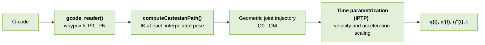
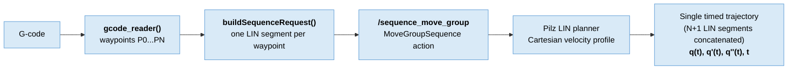

# Trajectory Planning

This document describes the trajectory planning layer developed for the proposed robotic additive manufacturing architecture. Its purpose is to explain how the geometric information contained in a G-code file is transformed into executable robot trajectories, from waypoint extraction to motion planning and time parametrization.

Two alternative planning strategies have been implemented within the `npam_trajectory` package: **Cartesian Interpolation** and the **Pilz Industrial Motion Planner**. Both approaches are examined in terms of their planning principles, motion characteristics and ability to control the position and velocity of the end effector.

Particular attention is paid to the dynamic behavior of the system. Since the UR10 moves the printing bed beneath a fixed extruder, the relative motion between the printing surface and the nozzle is a key parameter for the deposition process. In a non-planar additive manufacturing process, the **linear velocity of the TCP** has to be controlled precisely. In order to obtain a uniform deposition, the extrusion rate has to be consistent with that speed. This is the main parameter used to compare the two strategies.

The document covers the overall system architecture, the trajectory planning workflow and the implementation of both strategies. For installation instructions, see the [Quick start](../../README.md#quick-start), and for the robot model and planning environment configuration, see [simulation environment](simulation.md).

## Overview

| # | Section | Content |
|---|---------|---------|
| 1 | [Planning architecture](#1-planning-architecture) | General architecture proposed and information flow |
| 2 | [Common input: G-code](#2-common-input-g-code) | Waypoints received from a slicing stage |
| 3 | [Cartesian interpolation](#3-planner-a-cartesian-interpolation) | Algorithm, parameters and time parametrization |
| 4 | [Pilz Industrial Motion Planner](#4-planner-b-pilz-industrial-motion-planner) | Algorithm, constraints and Cartesian limits |
| 5 | [Comparison and recommended workflow](#5-comparison-and-recommended-workflow) | How to combine both strategies |

---

## 1. Planning architecture

This section focuses on the software components involved in trajectory generation, planning and execution, detailing the main interfaces used to connect the `npam_trajectory` package with MoveIt 2 and the [Universal Robots driver](https://github.com/UniversalRobots/Universal_Robots_ROS2_Driver/tree/humble).

  
   
  <b>Figure 1.</b> Planning architecture: <code>npam_trajectory</code>, <code>move_group</code>, <code>ros2_control</code> and RViz.

<!-- Figure 1: the architecture diagram with the four blocks (npam_trajectory, move_group, ros2_control, RViz) and some topics, services and actions between them. -->

 

The system is organized into three main functional blocks, together with the visualization environment:

- **`npam_trajectory`** (custom package): reads the G-code file through `gcode_reader()` and provides two planning strategies, implemented as two nodes: `npam_cartesian_planner` and `npam_pilz_planner`. Both approaches generate a single timed trajectory that is sent for execution. The Cartesian node communicates with MoveIt 2 only through `MoveGroupInterface`. The Pilz node uses an action client for `MoveGroupSequence` to plan, and `MoveGroupInterface` to query the planning frame and the end-effector link and to execute the resulting trajectory.
- **`move_group`** (MoveIt 2): provides the motion planning and execution capabilities. It keeps the planning scene up to date with the `PlanningSceneMonitor` and communicates with the robot controllers through the `MoveItSimpleControllerManager`, using the `FollowJointTrajectory` interface.
- **`ros2_control`** (ur_driver): manages the robot controllers through the `ControllerManager`. The main controllers used in the system are `scaled_joint_trajectory_controller`, `joint_state_broadcaster`, `io_and_status_controller` and `freedrive_mode_controller`. The `URPositionHardwareInterface` provides the connection with PolyScope, either on the physical robot or on the simulator.
- **RViz**: visualizes the robot state and planning scene. It receives the planning scene from `/monitored_planning_scene` and the robot state from `/tf`, `/tf_static` and `/joint_states`.

### **Interfaces between `npam_trajectory` and `move_group`**

The following ROS 2 interfaces are used by the implemented planning strategies:

| Interface | Type | Used by | Purpose |
|-----------|------|---------|---------|
| `/compute_cartesian_path` | Service | Cartesian interpolation | Computes a cartesian path using `MoveGroupCartesianPathService` |
| `/sequence_move_group` | Action | Pilz | Plans a sequence of motion commands using `MoveGroupSequenceAction` |
| `/execute_trajectory` | Action | Both | Requests the execution of a planned trajectory using `MoveGroupExecuteTrajectoryAction` |

> [!NOTE]
> The `scaled_joint_trajectory_controller` takes into account the speed scaling set on the Teach Pendant. When characterizing the dynamic behavior of the robot, keep in mind that the speed slider of the Teach Pendant can modify the real execution speed of a trajectory.

> [!NOTE]
> For additional details and complete information, refer to the oficial `ur_driver` [documentation](https://docs.universal-robots.com/Universal_Robots_ROS_Documentation/rolling/index.html#).
---

## 2. Common input: G-code

The waypoints for the trajectory are generated using a MATLAB slicing algorithm developed during the project. The resulting toolpath is stored in a G-code file following the *ISO 6983* standard.

The `gcode_reader()` function processes this file and extracts the waypoints that define the desired end-effector path. Each waypoint is represented as a cartesian pose:

$$Waypoints = \{P_0, P_1, \dots, P_N\} \quad \text{where each waypoint is defined by:} \quad P_i = \{X, Y, Z, Q_x, Q_y, Q_z, Q_w\}$$

Each pose contains the Cartesian position {X,Y,Z}, read from the `X`, `Y` and `Z` words, and the orientation as a quaternion {Qx,Qy,Qz,Qw}, read from the `I`, `J`, `K` and `W` words and normalized by the reader. Values are used as they are, without unit conversion, so they must be expressed in metres in the planning frame. Only lines starting with `G1` are processed. Lines that cannot be fully parsed are skipped with a warning, and the feedrate `F` is ignored.

## 3. Planner A: Cartesian interpolation

The first strategy uses the *Cartesian Path Computation* functionality provided by MoveIt 2 through `computeCartesianPath()`. It calculates a geometric path by interpolating in cartesian space through the input waypoints, starting from the current state of the robot, and solving the inverse kinematics at each interpolated pose. The resulting joint-space path is subsequently processed through a time parametrization algorithm to obtain a trajectory suitable for execution. 

### 3.1 Initial state

Before planning, the following information is configured for the planner:

- **URDF and SRDF:** define the robot model, planning groups and Allowed Collision Matrix (see [simulation environment](simulation.md)). 
- **Current state of the robot:** the node sets it as the initial state with `setStartStateToCurrentState()`. The path starts at the current pose of the robot, and its first segment goes from there to P0.
- **`kinematics.yaml`:** the configuration for the inverse kinematics solver.
- **`joint_limits.yaml`:** used during trajectory time parametrization.

### 3.2 Algorithm

The `computeCartesianPath()` function interpolates the path between consecutive waypoints in cartesian space. At each interpolated pose, the inverse kinematics solver calculates a corresponding joint configuration. The validity of the resulting path is evaluated against the planning scene, including collision checking.

The main parameters and considerations are:

| Parameter | Value | Meaning |
|---------------|:----:|-------|
| `eef_step` | 0.01 m | Maximum distance between two consecutive interpolated poses of the end effector |
| `jump_threshold` | 0.0 | Maximum jump allowed in joint space between consecutive points. A value of 0.0 disables the check |
| Collision checking | enabled (`avoid_collisions`, default `true`) | The computation stops at the first collision or IK failure |
| `fraction` | ≥ 0.95 expected | Part of the path that could be computed. Below 0.95 the node logs a warning |

The joint limits configured in [joint_limits.yaml](../../src/Universal_Robots_ROS2_Description/config/ur10/joint_limits.yaml) are also relevant to the subsequent time parametrization.

> [!WARNING]
> With `jump_threshold` set to 0.0, large jumps in joint space are not detected during planning. MoveIt's own tutorials note that disabling it is not recommended on real hardware, so the resulting trajectory should be checked for discontinuities before executing it on the robot. Likewise, if `fraction` is below 0.95 the node only logs a warning and still executes the partial trajectory.

The result of this step is a **geometric trajectory in joint space**, $\{Q_0, Q_1, \dots, Q_M\}$ with $M \geq N$ (each segment is subdivided according to `eef_step`), which does not include a valid timing for the execution.

### 3.3 Time parametrization

In order to obtain a trajectory that the robot can execute, timestamps, velocities and accelerations must be assigned to the calculated geometric path. This is done with the **Iterative Parabolic Time Parameterization (IPTP)** algorithm provided by MoveIt 2. The time parametrization stage:

- Assigns timestamps, velocities and accelerations to the geometric trajectory.
- Takes into account the joint limits defined in the robot model, those modified in `ur_description`.
- Applies the `velocity_scaling` and `acceleration_scaling` factors to scale the configured limits.

The final result is a continuous trajectory: $q(t), \dot{q}(t), \ddot{q}(t), t$.

### 3.4 Characteristics

- **Advantage:** it is an intuitive algorithm that relies on the joint limits configured in the robot model. The resulting motion is constrained by these limits and the selected scaling factors.
- **Disadvantage:** time parametrization is performed as a separate stage after cartesian path computation, introducing an additional step and a further set of parameters.
- **Limitation:** control over the TCP is lost. The linear velocity of the TCP is a *consequence* of the joint limits and of the geometry of the path, not an input. It is not constant along the trajectory.

---

## 4. Planner B: Pilz Industrial Motion Planner

The second strategy uses the **Pilz Industrial Motion Planner**, specifically its `LIN` motion command. Unlike the previous approach, the planner defines the motion directly in cartesian space and incorporates time parametrization into the planning process.

The input waypoints are converted into a sequence of linear motion commands, one for each waypoint. The first one starts from the current state of the robot and reaches P0; each following one starts from the end of the previous one.

### 4.1 Constraints per waypoint

The same waypoints are used as input, and a set of constraints is defined for each one:

| Constraint | Value |
|------------|-------|
| Position | Spherical region of radius 0.1 mm centred on the waypoint |
| Orientation | Target quaternion, with absolute tolerances of 0.01 rad per axis |

These constraints encode the target pose of each LIN segment: Pilz takes the goal pose from the centre of the position region and from the target orientation. No acceptance tolerance is applied to decide that the waypoint has been reached (to be confirmed by changing the radius and checking that the trajectory is identical).

### 4.2 Algorithm

The `LIN` planner generates an independent linear motion segment for each waypoint: the first one from the current state of the robot to P0, and each following one from the end of the previous segment. Therefore, N+1 segments are generated from N+1 input waypoints. Since all of them belong to the same planning group and use a blend radius of zero, Pilz concatenates them into a single trajectory.

The main characteristics of the planning process are:

| Aspect | Behavior |
|--------|----------|
| Position | Linear interpolation in cartesian space |
| Orientation | Quaternion interpolation with SLERP (*Spherical Linear Interpolation*) |
| Velocity profile | Trapezoidal, defined in cartesian space, with translation and rotation synchronized |
| IK solver | Configured in `kinematics.yaml` |
| Time parametrization | Included in the planning process. |

The planner generates the time information as part of the motion planning process, so no additional IPTP stage is required.

### 4.3 Configuration parameters

The velocity profile is defined in [pilz_cartesian_limits.yaml](../../src/Universal_Robots_ROS2_Driver/ur_moveit_config/config/pilz_cartesian_limits.yaml):

| Parameter | Description |
|-----------|-------------|
| `max_trans_vel` | Maximum translational velocity of the TCP |
| `max_trans_acc` | Maximum translational acceleration |
| `max_trans_dec` | Maximum translational deceleration (specified as a negative value in Pilz) |
| `max_rot_vel` | Maximum rotational velocity of the TCP |

Pilz assumes the same acceleration ratio for the translational and rotational trapezoidal profiles, so the rotational acceleration is derived from these values. The `max_velocity_scaling_factor` of the request scales the maximum cartesian velocities. In this implementation, the `velocity_scaling` parameter (default 1.0) is applied to both `max_velocity_scaling_factor` and `max_acceleration_scaling_factor` of every segment.

The output is a **single timed trajectory** built from the N+1 linear motion segments: $q(t), \dot{q}(t), \ddot{q}(t), t$.

> [!NOTE]
> Each `LIN` segment is planned independently, starting from the end state of the previous one, and the results are concatenated. In this implementation `blend_radius = 0.0` for every segment, so no blending is applied. Each segment starts and ends at zero velocity, therefore the planned velocity of the concatenated trajectory returns to zero at every waypoint (to be confirmed by plotting the TCP velocity). A blend radius greater than zero removes these stops at the cost of cutting corners. Blend radii must be non-negative and must not overlap, and the radius of the last segment must be zero.

### 4.4 Characteristics

- **Advantage:** the planner works in cartesian space, so the TCP velocity is bounded directly by `max_trans_vel`, which is the magnitude that matters for the deposition process. In addition, the time parametrization is part of the algorithm, so no extra step is required.
- **Disadvantage:** the workflow is more complex. Since the velocity profile is defined in cartesian space, the joint velocities needed to follow it depend on the geometry of the path. The planner checks them against the joint limits and the planning fails if they are exceeded, but an unsuitable TCP velocity can still leave the joints operating close to their limits.
- **Limitation:** `max_trans_vel` is an upper bound, not a set-point. With `blend_radius = 0` every segment starts and ends at rest, so the maximum velocity is only reached on segments longer than:

  $$d_{min} = \frac{v^2}{2}\left(\frac{1}{a} + \frac{1}{|dec|}\right)$$

  with $v$ = `max_trans_vel`, $a$ = `max_trans_acc` and $dec$ = `max_trans_dec`. On shorter segments the profile is triangular, and the average TCP velocity is lower than `max_trans_vel` and not constant.

> [!NOTE]
> According to the Pilz documentation, the planner uses the strictest combination of all the joint limits as a common limit for all joints. With the modified limits of this project (see [simulation environment](simulation.md)), this should be taken into account when interpreting the results.

---

## 5. Comparison and recommended workflow

The two strategies provide different approaches to generating executable trajectories from the same geometric input. Their main differences are summarized below.

| Criterion | Cartesian interpolation | Pilz (LIN) |
|-----------|-------------------------|------------|
| Motion definition | Cartesian path, solved in joint space through inverse kinematics | Cartesian path and cartesian velocity profile |
| TCP velocity control | Indirect: consequence of the joint limits | Upper bound set in `pilz_cartesian_limits.yaml` (`max_trans_vel`), reached only on segments longer than dmin |
| Time parametrization | Additional step (IPTP) | Included in the planner |
| Joint limits | Used to scale the motion | Checked on the result; planning fails if they are violated |
| Output | Single timed trajectory | Single timed trajectory (N+1 LIN segments concatenated) |
| Velocity at waypoints | Continuous (to be confirmed) | Zero at every waypoint if `blend_radius = 0` (to be confirmed) |
| Workflow | Simple | More complex |

> [!IMPORTANT]
> Because Pilz imposes an upper bound on the TCP velocity, an arbitrary value is not enough. The recommended workflow is to use Cartesian Planner to estimate a suitable cartesian velocity for the end effector, and then use Pilz planner. The proposed workflow is shown in detail in the [experimental document](validation.md):
>
> 1. Plan the trajectory with the **Cartesian Interpolation**.
> 2. **Study the linear velocity of the TCP** along the resulting trajectory.
> 3. From these results, **estimate a limit for the tangential velocity of the TCP** that the robot can sustain along the whole path.
> 4. Set that value in `max_trans_vel` and plan with **Pilz**.
> 5. **Check the TCP velocity actually achieved** by the Pilz trajectory: with `blend_radius = 0` and short segments it is lower than `max_trans_vel` and not constant.

---

