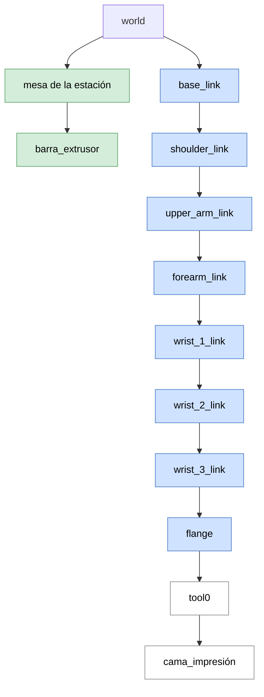

# Simulation Environment Configuration

This document describes how the Universal Robots packages were adapted to model the manufacturing station and the non-planar deposition process. It explains the starting point, the files that were modified, and the reason behind each change. For the installation steps, see the [Quick start](../../README.md#quick-start).

> [!TIP]
> The modified files are installed in the workspace during the build. After editing any of them, rebuild the workspace and source it again, as described in the [Quick start](../../README.md#installation).

## Overview

| # | Change | File | Package | Purpose |
|---|--------|------|---------|---------|
| 1 | [Kinematic calibration](#11-kinematic-calibration) | `kinematics.yaml` | `ur_description` | Represent the real UR10 of the station |
| 2 | [Joint velocity limits](#12-joint-velocity-limits) | `joint_limits.yaml` | `ur_description` | Generate slower and safer trajectories |
| 3 | [Station elements](#2-urdf-station-elements) | URDF (xacro) | `ur_description` | Model the print bed and the station environment |
| 4 | [Semantic information](#3-srdf-semantic-information-for-the-planner) | SRDF (xacro) | `ur_moveit_config` | Planning groups, reference poses and allowed collisions |

---

## Starting point

The simulation environment is built on top of the official ROS 2 packages released by Universal Robots (`humble` branch). All credit for the base packages goes to Universal Robots and their contributors; the changes described in this document are adaptations of their work.

| Package | Upstream repository | Role |
|---------|--------------------|------|
| `ur_description` | [Universal_Robots_ROS2_Description](https://github.com/UniversalRobots/Universal_Robots_ROS2_Description/tree/humble) | Robot models (URDF/xacro, meshes) and kinematic, physical and visual parameters of the UR series |
| `ur_robot_driver`, `ur_controllers`, `ur_calibration`, `ur_dashboard_msgs`, `ur_moveit_config`, `ur_bringup` | [Universal_Robots_ROS2_Driver](https://github.com/UniversalRobots/Universal_Robots_ROS2_Driver/tree/humble) | Communication with the real robot, controllers, calibration tools and MoveIt configuration |

The workspace includes modified copies of these packages. This is why the build command uses the `--allow-overriding` flag: the packages of the repository take priority over the versions already installed on the system.

**The manufacturing station.** In this application the robot does not hold the extruder. Instead, the UR10 carries the print bed on its flange, and the extruder is fixed to a bar of the station. The simulation therefore needs to represent both elements, together with the station table, so that the planner and the visualization are consistent with the real setup.

---

## 1. Kinematic model (`ur_description`)

`ur_description` provides the kinematic parameters of a generic UR10. These nominal values do not exactly match any individual robot, so two kinds of changes were made: the parameters were replaced by the calibrated values of the robot of the laboratory, and the joint velocity limits were reduced.

<div align="center">
  
  <br>
  <sub><b>Figure 1.</b> Changes in the kinematic model of <code>ur_description</code>.</sub>
</div>

### 1.1 Kinematic calibration

**Context**

Every UR robot is calibrated at the factory, and its real Denavit-Hartenberg (D-H) parameters, which differ slightly from the nominal ones, are stored in the robot controller. The `ur_calibration` package of the driver repository provides a tool to extract this calibration from the robot.

```bash
ros2 launch ur_calibration calibration_correction.launch.py \
  robot_ip:=192.168.XX.XXX \
  target_filename:="${HOME}/my_robot_calibration.yaml"
```

The calibrated values were transferred to `kinematics.yaml`, so that the model used by MoveIt (forward and inverse kinematics, and visualization) represents the real robot more faithfully. This improves both the simulation and the planning.

**Modified parameters**

| D-H parameter | Field in `.yaml` | Nominal value | Calibrated value | Difference |
|:---:|:---:|:---:|:---:|:---:|
| d1 | `shoulder.z` | 0.1273 m | 0.128131 m | +0.83 mm |
| a2 | `forearm.x` | -0.6120 m | -0.612669 m | -0.67 mm |
| a3 | `wrist_1.x` | -0.5723 m | -0.571167 m | +1.13 mm |
| d4 | `wrist_1.z` | 0.163941 m | 0.163773 m | -0.17 mm |
| d5 | `wrist_2.y` | -0.1157 m | -0.115833 m | -0.13 mm |
| d6 | `wrist_3.y` | 0.0922 m | 0.092289 m | +0.09 mm |
| - | `wrist_1.y` | 0 m | 0.001521 m | +1.52 mm |

The deviations are small (the largest is 1.52 mm), but they are not negligible for a deposition process, where the position of the TCP has to be accurate.

> [!NOTE]
> The calibration is specific to each robot unit. If the repository is used with a different UR10, the calibration has to be extracted again from that robot and the values updated.

### 1.2 Joint velocity limits

**Context**

The maximum joint velocities were modified manually in `joint_limits.yaml`. MoveIt takes these limits into account when it assigns timing to the trajectories, so lower limits produce slower trajectories, which are also safer to test in the laboratory.

| Parameter | Joint | Nominal value | Modified value | Reduction |
|-----------|:-----:|:---:|:---:|:---:|
| Maximum velocity | Shoulder link | 120 °/s | 20 °/s | 83 % |
| Maximum velocity | Elbow | 180 °/s | 120 °/s | 33 % |
| Maximum velocity | Wrist 2 | 180 °/s | 120 °/s | 33 % |
| Maximum velocity | Wrist 3 | 180 °/s | 120 °/s | 33 % |

---

## 2. URDF: station elements

**Context**

The URDF (*Unified Robot Description Format*) is the file that defines the geometric, kinematic and dynamic structure of the robot. In `ur_description` it is written with xacro macros. Besides the kinematic chain provided by Universal Robots, new elements were added in two ways:

- **Elements intrinsic to the kinematic chain:** the print bed, attached at the end of the chain (after `tool0`). It moves together with the robot.
- **Extrinsic elements:** the station table and the extruder bar, attached to the `world` frame. They are fixed and represent the environment of the simulation.

<div align="center">
  
  <br>
  <sub><b>Figure 2.</b> Frame tree of the modified URDF and its visualization in RViz 2.</sub>
</div>

<br>



| Color | Frames | Description |
|:-----:|--------|-------------|
| 🟦 Blue | `base_link` to `flange` | Kinematic chain of the robot (provided by Universal Robots) |
| 🟩 Green | Station table, extruder bar | Environment of the simulation, fixed to `world` |
| ⬜ White | `tool0`, print bed | End elements of the chain |

---

## 3. SRDF: semantic information for the planner

**Context**

The URDF describes how the robot is built, but it does not tell MoveIt how to use it. The SRDF (*Semantic Robot Description Format*) adds this semantic information. In this repository, the SRDF belongs to `ur_moveit_config`, which is distributed together with the Universal Robots driver. Three changes were made.

### 3.1 Planning groups

The planning groups define which elements the planner considers when it computes a motion. Two groups were defined:

- **Manipulator:** the robot arm alone.
- **Manipulator + print bed:** the robot arm together with the print bed, so that the planner takes it into account.

### 3.2 Predefined reference poses

Several typical joint configurations were stored in the SRDF, such as `home`, `up` or the start of the trajectory. They provide known poses to move the robot to when the tests are started.

### 3.3 Allowed collision matrix

MoveIt checks for collisions between every pair of links, unless the pair is explicitly disabled in the allowed collision matrix. The matrix was updated with the new elements of the URDF, and two kinds of pairs were disabled to avoid unnecessary checks:

- **Consecutive elements:** adjacent links are always in contact or overlapping by construction, so the checker would report collisions that are not real.
- **Elements that can never collide:** pairs of elements whose relative position never changes, such as the station table and the extruder bar, which are both fixed to `world`.

Previous works did not update the matrix, so collisions that should not have been considered were detected, such as the ones between consecutive elements.

> [!IMPORTANT]
> Every time a new element is added to the URDF, the allowed collision matrix has to be reviewed. Otherwise, MoveIt may report false collisions for the new element or ignore real ones.

---

## Adapting the environment to a different station

If the repository is used with another robot or another station layout, these are the steps to follow:

1. Extract the calibration of the new robot and update `kinematics.yaml`.
2. Review the joint velocity limits in `joint_limits.yaml`.
3. Modify the URDF to represent the new elements, as intrinsic (attached to the chain) or extrinsic (attached to `world`).
4. Update the SRDF: planning groups, reference poses and allowed collision matrix.
5. Rebuild the workspace and check the result in RViz 2.
