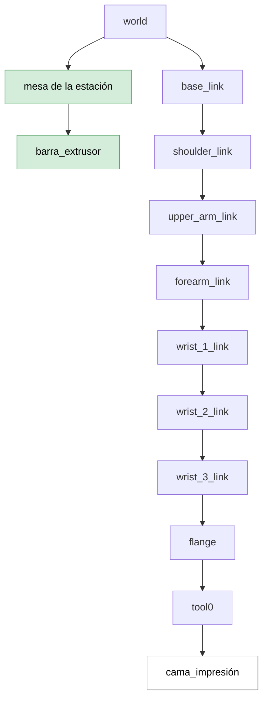

# Simulation Environment Configuration

## Purpose and Scope

This document describes the modifications implemented in the official Universal Robots ROS 2 packages to adapt the UR10 robot description and MoveIt 2 configuration to the robotic additive manufacturing station developed in this project.

The objective is to document the changes required to reproduce the simulated manufacturing environment, including the robot-especific kinematic parameters, the additional station elements and the semantic configuration used for motion planning.

## Overview

This document covers four main areas:

1. **Kinematic configuration:** adaptation of the robot model using the calibration data from the laboratory UR10 and modified joint velocity limits.
2. **URDF description:** integration of the printing bed and the main structural elements of the manufacturing station.
3. **SRDF configuration:** definition of planning groups, reference configurations and collision-checking rules.
4. **Environment adaptation:** guidelines for transferring the configuration to another robot or station layout.

For installation and workspace setup instructions, refer to the [Quick start](../../README.md#installation).

> [!IMPORTANT]
> The modified packages are built and installed within the project workspace, taking precedence over the corresponding system-installed versions. After modifying any of the configuration or description files, rebuild the workspace and source the installation again.
---

## Starting point: Universal Robots ROS 2 Packages

The simulation environment is based on the official ROS 2 packages provided by Universal Robots, using the humble branch as the starting point. These packages provide the robot description, meshes, kinematic parameters and MoveIt 2 configuration required to integrate a UR10 into a ROS 2 application.

| Package | Upstream repository | Role |
|---------|--------------------|------|
| `ur_description` | [Universal_Robots_ROS2_Description](https://github.com/UniversalRobots/Universal_Robots_ROS2_Description/tree/humble) | Robot models (URDF/xacro, meshes) and kinematic, physical and visual parameters of the UR series |
| `ur_robot_driver` | [Universal_Robots_ROS2_Driver](https://github.com/UniversalRobots/Universal_Robots_ROS2_Driver/tree/humble) | Communication and control of the physical robot. |
| `ur_controllers` | [Universal_Robots_ROS2_Driver](https://github.com/UniversalRobots/Universal_Robots_ROS2_Driver/tree/humble) | Robot controllers and hardware interfaces. |
| `ur_calibration` | [Universal_Robots_ROS2_Driver](https://github.com/UniversalRobots/Universal_Robots_ROS2_Driver/tree/humble) | Extraction and application of robot-specific calibration parameters. |
| `ur_moveit_config` | [Universal_Robots_ROS2_Driver](https://github.com/UniversalRobots/Universal_Robots_ROS2_Driver/tree/humble) | MoveIt 2 configuration for Universal Robots manipulators. |

The project workspace contains modified copies of the packages required by the application. However, it is recomended to create new files for new applications. 

The following sections describe the modifications made to the robot description and planning configuration.

---

## 1. Kinematic model (`ur_description`)

The official [ur_description](https://github.com/UniversalRobots/Universal_Robots_ROS2_Description/tree/humble) package provides a parameterized model of the UR10. However, the nominal kinematic parameters do not exactly represent the geometry of the actual robot, and the default joint velocity limits were not suitable for the initial testing conditions of this application.

Two modifications were therefore introduced:

- Replacement of the nominal kinematic parameters with the calibration data extracted from the laboratory UR10.
- Reduction of selected joint velocity limits to obtain slower robot trajectories for safer movements.

### 1.1 Kinematic calibration

Each Universal Robots manipulator is factory-calibrated. The resulting robot-specific kinematic parameters differ slightly from the nominal values used in the generic robot description. The `ur_calibration` package provides a tool to extract these parameters from the robot controller and generate a calibration file.

The calibration was obtained using the following command:

```bash
ros2 launch ur_calibration calibration_correction.launch.py robot_ip:=192.168.XX.XXX target_filename:="${HOME}/my_robot_calibration.yaml"
```
The extracted values were transferred to the corresponding [default_kinematics.yaml](../../src/Universal_Robots_ROS2_Description/config/ur10/default_kinematics.yaml) configuration file in `ur_description`. This ensures that the robot model used by MoveIt 2 represents the geometry of the physical UR10 more accurately, particularly when calculating forward and inverse kinematics and the position of the tool reference frame.

**Modified parameters**

| D-H parameter | Field in `.yaml` | Nominal value | Calibrated value | Difference |
|:---:|:---:|:---:|:---:|:---:|
| d1 | `shoulder.z` | 0.1273 m | 0.128131 m | +0.83 mm |
| a2 | `forearm.x` | -0.6120 m | -0.612669 m | -0.67 mm |
| a3 | `wrist_1.x` | -0.5723 m | -0.571167 m | +1.13 mm |
| d4 | `wrist_1.z` | 0.163941 m | 0.163773 m | -0.17 mm |
| d5 | `wrist_2.y` | -0.1157 m | -0.115833 m | -0.13 mm |
| d6 | `wrist_3.y` | 0.0922 m | 0.092289 m | +0.09 mm |
| - | `wrist_1.y` | 0 m | 0.001521 m | +1.52 mm |

Although the differences are relatively small, they can affect the accuracy of the tool position. This is particularly relevant in additive manufacturing, where the relative position and orientation of the deposition surface must be represented consistently.

> [!NOTE]
> The calibration data is specific to each robot unit. If the configuration is used with another UR10, the calibration must be extracted again and the corresponding values updated.

### 1.2 Joint velocity limits

The default joint velocity limits were reduced to obtain more controlled robot movements during trajectory execution and laboratory testing.

The modifications were implemented in [joint_limits.yaml](../../src/Universal_Robots_ROS2_Description/config/ur10/joint_limits.yaml). MoveIt 2 uses these limits when time-parameterizing planned trajectories, ensuring that the resulting joint velocities do not exceed the configured maximum values.

| Parameter | Joint | Nominal value | Modified value | Reduction |
|-----------|:-----:|:---:|:---:|:---:|
| Maximum velocity | Shoulder link | 120 °/s | 20 °/s | 83 % |
| Maximum velocity | Elbow | 180 °/s | 120 °/s | 33 % |
| Maximum velocity | Wrist 2 | 180 °/s | 120 °/s | 33 % |
| Maximum velocity | Wrist 3 | 180 °/s | 120 °/s | 33 % |

The shoulder velocity was reduced more significantly than the other joints, limiting the overall speed of the robot during the initial tests.

---

## 2. Manufacturing Station Description (URDF)

The original URDF (*Universal Robot Description File*) describes the geometry and kinematic structure of the UR10 manipulator. However, the manufacturing application requires a more complete representation of the physical station. 

Unlike conventional robotic additive manufacturing configurations in which the extruder is mounted directly on the robot, the proposed setup uses a different arrangement:

- The printing bed is attached to the robot flange and moves together with the manipulator.
- The extruder support structure is fixed to the station and remains stationary during robot motion.
- The station table provides the common reference for the surrounding environment.


**Implemented modifications**

The printing bed was added as a new link after tool0, connected through a fixed joint. Consequently, its position and orientation are determined by the robot configuration.

Conversely, the station table and extruder bar were added as elements external to the robot kinematic chain. They are attached to the world reference frame through fixed joints, so their positions remain unchanged when the robot moves.

The integration of the new elements also required extending the robot's frame structure. The resulting [URDF description](../../src/Universal_Robots_ROS2_Description/urdf/ur_macro.xacro) can be summarized as follows:


<br>



| Category | Frames | Description |
|:-----:|--------|-------------|
| 🟦 Robot | `base_link` to `tool0` | Original UR10 kinematic chain. |
| 🟩 End-effector | Printing bed | Printing bed attached to the robot. |
| ⬜ Station environment |  Station table, extruder bar | Fixed elements representing the manufacturing station. |

---

## 3. SRDF: semantic information for the planner

While the URDF defines the robot's geometric and kinematic structure, the SRDF (*Semantic Robot Description Format*) provides additional information required by MoveIt 2 to configure and plan robot motions.

The [SRDF configuration](../../src/Universal_Robots_ROS2_Driver/ur_moveit_config/srdf/ur_macro.srdf.xacro) was adapted in the ur_moveit_config package to account for the new end-effector and the manufacturing station. Three main aspects were modified:

- Planning groups.
- Predefined reference configurations.
- Allowed collision matrix.

### 3.1 Planning groups

Planning groups define which joints and links are considered when MoveIt 2 calculates a robot motion. Two planning groups were defined:

- **Manipulator:** the robot arm alone.
- **Manipulator + print bed:** includes the robot arm and its printing bed, allowing the end-effector geometry to be considered during motion planning and collision checking.

This distinction allows the planning configuration to account for the additional geometry attached to the robot when required.

### 3.2 Predefined reference poses

Several typical joint configurations were stored in the SRDF, such as `HOME`, `UP` or the `START` of the trajectory. They provide known poses to move the robot to when the tests are started.

### 3.3 Allowed collision matrix

MoveIt 2 uses the Allowed Collision Matrix (ACM) to determine which pairs of robot links and environment objects must be checked for collisions.

When new elements are added to the URDF, the collision configuration must also be reviewed. Otherwise, the planning scene may report collisions between elements that are expected to be in contact or may perform unnecessary collision checks. The main modifications concerned two types of pairs:

- **Adjacent elements in the kinematic chain:** selected pairs of consecutive links were excluded from collision checking where their geometry or mechanical connection would otherwise produce expected contact or overlapping collision meshes.
- **Elements that can never collide:** pairs of elements whose relative position never changes, such as the station table and the extruder bar, which are both fixed to `world`.

These exclusions reduce unnecessary collision checks and prevent false collision reports during planning.

> [!IMPORTANT]
> Collision exclusions must be reviewed whenever the URDF or station geometry changes. Only pairs that cannot produce a relevant collision in the intended operating conditions should be disabled. The remaining collision checks are essential to ensure that planned trajectories are valid with respect to the robot and its environment.

---

## Adapting the environment to a different station

If the repository is used with another robot or another station layout, these are the steps to follow:

1. Extract the calibration of the new robot and update `kinematics.yaml`.
2. Review the joint velocity limits in `joint_limits.yaml`.
3. Modify the URDF to represent the new elements, as intrinsic (attached to the chain) or extrinsic (attached to `world`).
4. Update the SRDF: planning groups, reference poses and allowed collision matrix.
5. Rebuild the workspace and check the result in RViz 2.

This procedure allows the simulation environment to be extended while maintaining consistency between the robot description, the manufacturing station and the MoveIt 2 planning configuration.
