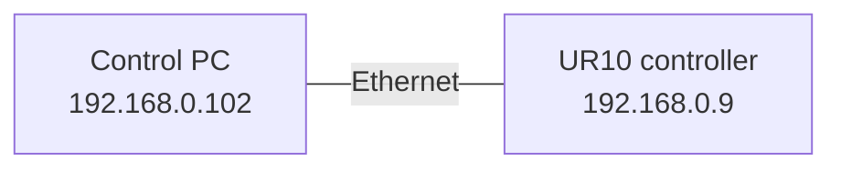
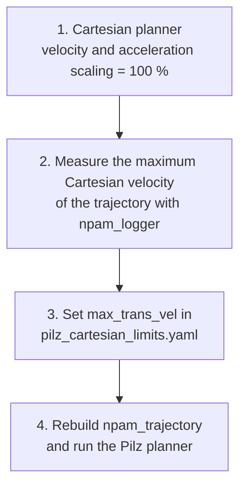

# Experimental Validation

This document collects the preparation steps, the tests carried out on the real UR10 and the results obtained. The main goal of these tests is to **control the robot from ROS 2 without using the Teach Pendant** to run trajectories, and to validate the planning workflow described in [Trajectory Planning](planning.md). For the installation steps see the [Quick start](../../README.md#quick-start), and for common errors see [Troubleshooting](troubleshooting.md).

> [!TIP]
> All the commands in this document assume that the workspace has been built and sourced, as described in the [Quick start](../../README.md#installation). Each long-running command (driver, MoveIt, planners, loggers) needs its own terminal.

## Overview

| # | Section | Content |
|---|---------|---------|
| 1 | [Test setup](#1-test-setup) | Environments, network configuration and startup sequence |
| 2 | [Driver and External Control](#2-driver-and-external-control) | Launching the driver and handing the control to ROS 2 |
| 3 | [Teach Pendant control from ROS](#3-teach-pendant-control-from-ros) | Dashboard tests: messages, freedrive, state monitoring |
| 4 | [Motion tests](#4-motion-tests) | Launching MoveIt and the planners, data acquisition |
| 5 | [Workflow for a new trajectory](#5-workflow-for-a-new-trajectory) | How to choose `max_trans_vel` before using Pilz |
| 6 | [Results](#6-results) | Cartesian interpolation and Pilz |

---

## 1. Test setup

### 1.1 Test environments

The tests can be run on the real robot or on the URSim simulator. The only difference in the launch commands is the IP address of the robot.

| Environment | `robot_ip` | Notes |
|-------------|:----------:|-------|
| Real UR10 | `192.168.0.9` | Requires the network configuration of the next section |
| URSim (Docker) | `192.168.56.101` | Optional, see [section 1.4](#14-optional-simulated-robot-ursim) |

### 1.2 Network configuration (real robot)

The robot and the control PC are connected directly through Ethernet, so the network has to be configured on both sides before starting.



**On the Teach Pendant**

Go to `Setup Robot → Network` and set the following parameters:

| Parameter | Value |
|-----------|:-----:|
| IP address | `192.168.0.9` |
| Subnet mask | `255.255.255.0` |
| Default gateway | `192.168.0.9` |
| Preferred DNS server | `192.168.0.9` |
| Alternative DNS server | `0.0.0.0` |

In addition, the user name of the computer used has to be added.

**On the PC**

1. Disable the WiFi and any other active network interface that uses the same IP range.
2. Create a new Ethernet connection with the following parameters:

| Parameter | Value |
|-----------|:-----:|
| IPv4 mode | Manual |
| Address | `192.168.0.102` |
| Netmask | `255.255.255.0` |
| Gateway | `192.168.0.1` |

3. Check the connection by pinging the robot:

```bash
ping 192.168.0.9
```

If the connection is established, the output should be similar to:

```text
64 bytes from 192.168.0.9: icmp_seq=1 ttl=64 time=0.670 ms
64 bytes from 192.168.0.9: icmp_seq=2 ttl=64 time=0.332 ms
```

> [!NOTE]
> The robot needs a static IP address. Otherwise the `robot_ip` parameter may change between sessions. See the [official network setup guide](https://docs.universal-robots.com/Universal_Robots_ROS2_Documentation/doc/ur_client_library/doc/setup/network_setup.html).

### 1.3 Startup sequence

The startup sequence is always the same:

1. Start the Teach Pendant and the computer.
2. Check the network connection between the Teach Pendant and the computer with `ping`.
3. Start the robot and release the brakes from the Teach Pendant.
4. Launch the ROS driver on the computer.
5. Check that the robot state is `RUNNING`.
6. Activate `external_control.urp`.
7. Check the state of the robot, the program and the safety.

### 1.4 (Optional) Simulated robot: URSim

To test without hardware, Universal Robots provides a simulator packaged as a Docker image. The following command starts it:

```bash
ros2 run ur_client_library start_ursim.sh -m ur10
```

If the command runs without problems, a port is opened on the computer and the simulator is accessible from the browser at `http://localhost:6080`. If Docker reports a `permission denied` error, see [Troubleshooting](troubleshooting.md#docker-permission-denied).

---

## 2. Driver and External Control

Before handing the control to ROS 2, the controllers have to be launched through the [Universal Robots driver](https://github.com/UniversalRobots/Universal_Robots_ROS2_Driver/tree/humble):

```bash
ros2 launch ur_robot_driver ur_control.launch.py ur_type:=ur10 robot_ip:=192.168.0.9 launch_rviz:=false
```

Once the driver is running, check that the dashboard services are active:

```bash
ros2 service list | grep dashboard
```

**Activating External Control**

The control of the robot is handed to ROS through the `external_control.urp` program, which has to be installed beforehand on the Teach Pendant. It can be started from the Teach Pendant or with the dashboard services:

```bash
ros2 service call /dashboard_client/load_program ur_dashboard_msgs/srv/Load "filename: /programs/usbdisk/PedroAcero/externalControl.urp"
ros2 service call /dashboard_client/play std_srvs/srv/Trigger {}
```

> [!NOTE]
> Without this step, MoveIt 2 cannot send commands to the robot. If there is a problem or the External Control has to be reinstalled, follow the [robot setup guide](https://docs.universal-robots.com/Universal_Robots_ROS2_Documentation/doc/ur_client_library/doc/setup/robot_setup.html). The External Control node of the program also has to point to the IP address of the PC (`192.168.0.102` in this setup).

---

## 3. Teach Pendant control from ROS

These tests were designed with four objectives:

- Become familiar with the laboratory work environment.
- Document the specific connection data between the robot and the PC.
- Make a first contact with the control of the robot from ROS.
- Diagnose the disconnection timeout of the External Control.

### 3.1 Writing messages on the Teach Pendant

Add an entry to the log of the robot:

```bash
ros2 service call /dashboard_client/add_to_log ur_dashboard_msgs/srv/AddToLog "{message: 'Message from my PC: hello world'}"
```

Show a popup and close it:

```bash
ros2 service call /dashboard_client/popup ur_dashboard_msgs/srv/Popup "{message: 'Press OK to continue'}"
ros2 service call /dashboard_client/close_popup std_srvs/srv/Trigger "{}"
```

### 3.2 Freedrive

The robot can be moved by hand through the freedrive mode:

```bash
ros2 topic pub --rate 2 /freedrive_mode_controller/enable_freedrive_mode std_msgs/msg/Bool "{data: true}"
```

> [!WARNING]
> This function requires the `freedrive_mode_controller` to be active. It can be activated from the controller manager GUI, with a right click on the controller:
> ```bash
> ros2 run rqt_controller_manager rqt_controller_manager
> ```

To see all the services available in the environment:

```bash
ros2 service list
```

### 3.3 Monitoring the state of the robot

During the tests, the state of the robot should be checked from time to time. A timeout that disconnects the External Control without warning had been reported, and diagnosing it was a secondary objective of these tests, although a very important one. <!-- TODO: add the conclusions of the timeout diagnosis -->

**Program state**

```bash
ros2 service call /dashboard_client/program_state ur_dashboard_msgs/srv/GetProgramState "{}"
```

| State | Description |
|-------|-------------|
| `STOPPED` | No program is running |
| `PLAYING` | A program is loaded and running |
| `PAUSED` | A program is loaded and paused |

> [!NOTE]
> When the External Control is active, the program state should be `PLAYING`.

**Robot mode**

```bash
ros2 service call /dashboard_client/get_robot_mode ur_dashboard_msgs/srv/GetRobotMode "{}"
```

<details>
<summary><b>Possible robot modes</b></summary>

| Value | State | Description |
|:-----:|-------|-------------|
| -1 | `NO_CONTROLLER` | No controller detected |
| 0 | `DISCONNECTED` | No connection with the robot |
| 1 | `CONFIRM_SAFETY` | Waiting for confirmation after a stop |
| 2 | `BOOTING` | Robot is starting up |
| 3 | `POWER_OFF` | Power is off |
| 4 | `POWER_ON` | Power is on, but the robot is not operational |
| 5 | `IDLE` | Robot is operational, waiting for a program |
| 6 | `BACKDRIVE` | Freedrive mode |
| 7 | `RUNNING` | A program is running |
| 8 | `UPDATING_FIRMWARE` | Robot software is being updated |

</details>

**Safety mode**

```bash
ros2 service call /dashboard_client/get_safety_mode ur_dashboard_msgs/srv/GetSafetyMode "{}"
```

<details>
<summary><b>Possible safety modes</b></summary>

| Value | State | Description |
|:-----:|-------|-------------|
| 1 | `NORMAL` | The robot accepts motions and services |
| 2 | `REDUCED` | The robot accepts motions with limitations |
| 3 | `PROTECTIVE_STOP` | The controller detects that the requested motion cannot be performed |
| 4 | `RECOVERY` | State of the robot after a safety event |
| 5 | `SAFEGUARD_STOP` | Safeguard system |
| 6 | `SYSTEM_EMERGENCY_STOP` | System-level stop |
| 7 | `ROBOT_EMERGENCY_STOP` | Robot-level stop |
| 8 | `VIOLATION` | - |
| 9 | `FAULT` | Safety fault, contact technical support |
| 10 | `VALIDATE_JOINT_ID` | Safety fault, manufacturer's responsibility |
| 11 | `UNDEFINED_SAFETY_MODE` | Undefined inconsistency |
| 12 | `AUTOMATIC_MODE_SAFEGUARD_STOP` | - |
| 13 | `SYSTEM_THREE_POSITION_ENABLING_STOP` | - |

</details>

### 3.4 Restoring the operation mode

If the connection with the robot is lost because of the timeout or any other reason, the state of the robot can be recovered with the following command:

```bash
ros2 action send_goal /ur_robot_state_helper/set_mode ur_dashboard_msgs/action/SetMode "{ target_robot_mode: 7, stop_program: true, play_program: true}"
```

This action tries to take the robot to the `RUNNING` mode (7), stops the active program and launches it again.

### 3.5 Reading positions

To obtain positions or to check trajectories, the state of the robot can be read with the following commands.

```bash
ros2 topic echo /joint_states
```

This topic publishes the joint positions of the robot.

```bash
ros2 run tf2_ros tf2_echo world cama_impresion
```

This tool prints the transformation between two reference frames, as a position (Cartesian coordinates) and a unit quaternion.

---

## 4. Motion tests

### 4.1 Launching the system

With the driver running and the External Control active, the rest of the system is launched in separate terminals.

**1. MoveIt 2**

```bash
ros2 launch ur_moveit_config ur_moveit.launch.py ur_type:=ur10 launch_rviz:=true
```

**2. Planner** (one of the two)

```bash
ros2 launch npam_trajectory cartesian_trajectory.launch.py velocity_scaling:=1.0 acceleration_scaling:=1.0
```

```bash
ros2 launch npam_trajectory pilz_trajectory.launch.py
```

**3. Loggers**

```bash
ros2 run npam_logger plan_logger
```

```bash
ros2 run npam_logger commanded_logger
```

> [!NOTE]
> It is recommended to start the driver and MoveIt 2 in different terminals, so that the messages of each component can be identified and analysed independently.

### 4.2 Data acquisition

The planned and the commanded motions are recorded with timestamps by subscribing to two topics. <!-- TODO: confirm which logger records each topic -->

| Data | Topic | Message type | Joint quantities |
|------|-------|--------------|------------------|
| Planned | `/display_planned_path` | `moveit_msgs/msg/DisplayTrajectory` | Positions in rad, velocities in rad/s, accelerations in rad/s², times in s |
| Commanded | `/scaled_joint_trajectory_controller/state` | `control_msgs/msg/JointTrajectoryControllerState` | Positions in rad, velocities in rad/s, accelerations in rad/s² |

ROS messages use SI units (angles in radians), so the joint velocities published by these topics are in **rad/s**. Neither topic publishes mm/s; a Cartesian speed of the TCP would be in m/s, which is also the unit of `max_trans_vel`.

> [!NOTE]
> The tables and figures of this document state the unit of each magnitude. If a velocity is converted from rad/s to °/s for the analysis, the axis labels must be changed accordingly.

### 4.3 Useful checks

Check the position, the velocity and the transformations:

```bash
ros2 topic echo /joint_states --once
```

```bash
ros2 topic echo /scaled_joint_trajectory_controller/state
```

```bash
ros2 run tf2_ros tf2_echo world cama_impresion 2>/dev/null | grep -E "Translation|Quaternion"
```

### 4.4 Changing the controller parameters

The tolerance of the trajectory tracking of the `scaled_joint_trajectory_controller` can be modified at runtime. The following command sets it to 5.0 for all the joints: <!-- TODO: explain why it was needed in the tests -->

```bash
ros2 param set /scaled_joint_trajectory_controller constraints.shoulder_pan_joint.trajectory 5.0 && \
ros2 param set /scaled_joint_trajectory_controller constraints.shoulder_lift_joint.trajectory 5.0 && \
ros2 param set /scaled_joint_trajectory_controller constraints.elbow_joint.trajectory 5.0 && \
ros2 param set /scaled_joint_trajectory_controller constraints.wrist_1_joint.trajectory 5.0 && \
ros2 param set /scaled_joint_trajectory_controller constraints.wrist_2_joint.trajectory 5.0 && \
ros2 param set /scaled_joint_trajectory_controller constraints.wrist_3_joint.trajectory 5.0
```

> [!WARNING]
> This is a very permissive value, which practically disables the check of the tracking error during the execution. It should only be used in controlled tests, never as a default configuration.

---

## 5. Workflow for a new trajectory

The Pilz planner imposes the linear velocity of the TCP through the `max_trans_vel` parameter of `pilz_cartesian_limits.yaml`. This is **the most important parameter to control in a non-planar additive manufacturing process**, because there is a direct relationship between the extrusion speed (the deposition of material) and the tangential speed of the TCP. For this reason, a value for `max_trans_vel` has to be estimated before using Pilz with a new trajectory.



> [!IMPORTANT]
> Follow this workflow every time a new trajectory is going to be executed with Pilz:
>
> 1. Run the **Cartesian planner** with a scaling of 100 %. The **joint** velocities of the robot are bounded by the limits set in `joint_limits.yaml`.
> 2. With the help of `npam_logger`, measure the maximum **Cartesian** velocity reached along the trajectory.
> 3. Set that value in the `max_trans_vel` parameter of `pilz_cartesian_limits.yaml`.
> 4. Rebuild `npam_trajectory` and run the **Pilz planner**.

The rebuild is needed because the configuration file is installed in the workspace during the build:

```bash
cd ~/workspace
colcon build --packages-select npam_trajectory
source install/setup.bash
```

After running Pilz, the joint velocities should be checked against the limits (see [section 6.2](#62-pilz-estimating-max_trans_vel)).

---

## 6. Results

The tests were carried out with a trajectory obtained during the INGENIA course. It is a particularly interesting case because it describes a **continuous surface** and it allows the **dynamic characterization of the joints at the ends** of the kinematic chain. <!-- TODO: indicate the name of the trajectory -->

### 6.1 Cartesian interpolation: influence of the scaling

For a single calculated trajectory, the velocity scaling was varied to study its influence on the execution. Figures 1 and 2 compare the planned velocity of a joint, which has a trapezoidal profile, with the commanded velocity recorded during the execution. <!-- TODO: indicate which joint is plotted and the trajectory used -->

<div align="center">
  
  <br>
  <sub><b>Figure 1.</b> Planned and commanded joint velocity with a velocity scaling of 90 % and an acceleration scaling of 20 %.</sub>
</div>

<br>

<div align="center">
  
  <br>
  <sub><b>Figure 2.</b> Planned and commanded joint velocity with a velocity scaling of 25 % and an acceleration scaling of 20 %.</sub>
</div>

<br>

In both figures the commanded velocity follows the shape of the plan but with a smoother profile, and its peaks are below the plateau of the planned trapezoid. Comparing all the scaling values tested, the commanded velocity reaches the setpoint of the trapezoidal profile in only one of them. <!-- TODO: indicate which combination of scaling values -->

> [!NOTE]
> Studying the technological limits of the process, that is, the velocities and accelerations that the system can actually track, is proposed as future work.

### 6.2 Pilz: estimating `max_trans_vel`

The first step of the Pilz workflow is to estimate the limit of the Cartesian velocity. To quantify how much margin the trajectory leaves, the Pilz planner was run on the study trajectory with a **very low value of `max_trans_vel` (0.01 m/s)**, and the maximum velocity reached by each joint was compared with its configured limit.

| Joint | Maximum velocity (°/s) | Configured limit (°/s) | Relative use (%) |
|-------|:---:|:---:|:---:|
| Shoulder pan | 0.767 | 20 | 3.83 |
| Shoulder lift | 1.423 | 120 | 1.19 |
| Elbow | 2.514 | 120 | 2.09 |
| Wrist 1 | 1.219 | 180 | 0.68 |
| Wrist 2 | 0.828 | 120 | 0.69 |
| **Wrist 3** | **15.876** | 120 | **13.23** |

<!-- TODO: confirm the unit of the velocities in this table (see the units note in section 4.2) -->

The limiting joint is the last one, **`wrist_3`**, which uses 13.23 % of its limit, while the next one (`shoulder_pan`) uses 3.83 %. Figure 3 shows its velocity along the execution.

<div align="center">
  
  <br>
  <sub><b>Figure 3.</b> Velocity of the <code>wrist_3</code> joint with <code>max_trans_vel</code> = 0.01 m/s.</sub>
</div>

<br>

**Margin to increase the tangential velocity**

For a fixed path, the joint velocities are proportional to the velocity of the TCP. Therefore, the usage of the limiting joint gives a theoretical upper bound for `max_trans_vel`:

$$k_{max} = \frac{100\,\%}{13.23\,\%} \approx 7.6 \qquad \Rightarrow \qquad v_{max} \approx 0.01\ \text{m/s} \times 7.6 \approx 0.075\ \text{m/s}$$

This means that there is a wide margin to increase the tangential velocity of the TCP and optimize the process. This estimate should be used with care:

- It is an upper bound at 100 % of the joint limit, so a safety margin should be kept.
- It only takes into account the velocity limits. The acceleration limits, the ramps of the trapezoidal profile and the transitions between segments have to be checked in a new run.
- It is based on the peak values of the measurement, which include spikes above the typical plateau of the signal.

<!-- TODO: indicate the value of max_trans_vel finally selected and the result of the verification run -->
